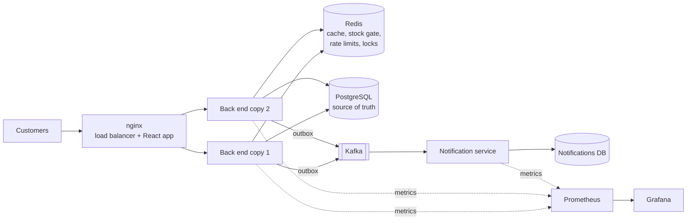

# CommerceHub

A small online store, front end and back end: customers browse products, fill a cart and place orders; the shop owner manages products, stock and orders.

It is built around one problem: **when only a few units are left and many people order at the same moment, the shop must never sell more than it has.**

React + TypeScript (Vite) · Java 17 · Spring Boot 3.5 · PostgreSQL · Kafka · Redis · Spring Security (JWT) · Resilience4j · nginx · Prometheus + Grafana · k6 · Docker · GitHub Actions

> Phases 1 to 4 are built (store, payments, order events with Kafka, scaling and reliability). Planned next: Kubernetes and a public deployment.

## What it does

**Customers**
- Browse products with search, category filter, sorting and pages
- See how much stock is left on every product
- Add to cart, change quantities, place an order and pay for it
- Come back and pay an order that is still waiting, or cancel it
- See their own orders and each order's status

**Shop owner (admin)**
- Add and edit products, hide them from the shop
- Correct stock up or down, see which products are running low
- See every order and move it from placed to shipped to delivered

## How overselling is prevented

Stock is never changed by "read the number, change it in Java, save it back", because two orders doing that at the same moment overwrite each other. Instead, checkout runs one database statement per product:

```sql
UPDATE products SET stock = stock - :quantity
WHERE id = :productId AND stock >= :quantity
```

The database runs this as a single step. If it changes one row, the stock was reserved. If it changes none, there was not enough, the order is refused and everything the order had reserved so far is rolled back. Stock can never go below zero.

Other details that follow from the same idea:
- Cancelling an order first flips its status from PLACED to CANCELLED in one statement, and only the request that made that change gives the stock back. Two cancel requests cannot return the stock twice.
- Editing a product's name or price never writes the stock column, so it cannot undo an order placed in between.
- An order stores the name and price at the time of purchase, so later price changes do not rewrite it.

## How payment works

Placing an order is two steps, because an order should not count until it is paid.

1. **Checkout** creates the order as "awaiting payment" and holds the stock. The server works out the amount from the order it just built; the browser never sends a price.
2. **Payment** happens in the payment company's window. When it reports success, the server checks the signature (HMAC-SHA256 with a secret only the server and the payment company know) before marking the order paid. A forged or altered "payment succeeded" message is refused.

Things that can go wrong, and what happens:

| Situation | Result |
|---|---|
| Customer closes the browser right after paying | The payment company's server-to-server notification (webhook) still confirms the order |
| Browser and webhook both report the same payment | Confirmed once; the second report changes nothing |
| Customer never pays | After 15 minutes the order is cancelled and the stock goes back on sale |
| Payment arrives after the order was cancelled | The order stays cancelled and the payment is flagged for refund |
| Webhook reports a different amount than the order | Ignored |

Talking to the payment company is a network call, so it is done outside any database transaction: no product rows stay locked while waiting on the network.

**Two modes.** With Razorpay test keys set (`RAZORPAY_KEY_ID`, `RAZORPAY_KEY_SECRET`), the real Razorpay payment window opens. Without keys the app runs in demo mode: a confirmation box stands in for the payment window, and the same signature check runs behind it. Both modes have been run: an order was paid through Razorpay's test-mode window and confirmed after signature verification. The webhook is covered by automated tests but has not yet received a live call from Razorpay, because that needs a public address.

## Order events with Kafka

When an order is created, paid, shipped, delivered or cancelled, the shop publishes an event. A separate program, the **notification service**, listens and records an update for the customer, which the shop shows as the order's timeline. The two programs share nothing but the Kafka topic: the notification service has its own database and never reads the shop's tables.

```
shop back end ── writes order + event in ONE transaction ──> outbox table
                                                               │  (every second)
                                                               ▼
                                                            Kafka topic
                                                               │
                                                               ▼
                                              notification service ──> its own database
```

Two problems this design deals with:

**An event must never be lost.** Saving an order and sending a Kafka message are two different systems; if the app saved the order and crashed before sending, the event would be gone. So the event is first written to an `outbox_events` table in the same database transaction as the order change: both are saved or neither is. A background job sends outbox rows to Kafka, waits for Kafka's acknowledgement, and only then marks them sent. If Kafka is down, the events wait in the table and go out when it is back, in their original order. (This is the outbox pattern.)

**An event may arrive twice.** If the app stops after Kafka acknowledged but before the row was marked sent, that event is sent again. Delivery is therefore at-least-once, and the notification service is written to be safe to repeat: every event carries a unique id, the `notifications` table has a unique rule on it, and a repeat is recognised and skipped.

**Checked by hand (4 Oct 2026).** With all three programs running, an order's "placed" and "paid" updates appeared on its timeline within seconds. Then Kafka was stopped: a new order was still placed and paid normally, with no timeline. After Kafka was started again, that order's two updates appeared, in the right order. The same behaviour is covered by automated tests using a stand-in for Kafka.

## Scaling and reliability

The back end runs as **several identical copies behind an nginx load balancer**. No copy keeps anything important in its own memory: data lives in PostgreSQL, and the cache, counters and locks live in Redis. So any copy can answer any request, copies can be added for more traffic, and one copy dying does not take the shop down.



| Problem | What the shop does |
|---|---|
| Most traffic is people browsing | Product lists, product pages and categories are cached in Redis (cache-aside). Any admin change bumps a version number, so every old entry is dropped at once. A cache hit does not even borrow a database connection. |
| Flash sale: thousands of people want the same few units at the same moment | A **Redis stock gate** (atomic Lua script) answers "sold out" in about a millisecond for everyone who cannot get a unit, so only the few real buyers reach the database. PostgreSQL still does the final, exact stock update, so the gate can never cause overselling. |
| A user or bot hammers checkout or login | **Rate limits** per user in Redis (5 checkouts per 10 s, 10 logins per minute), shared by all copies. Answered with HTTP 429. |
| The database is overwhelmed | The connection pool waits at most 5 s, then the request gets a quick **503 "try again"** instead of hanging. |
| The payment provider is slow or down | **Retry** with backoff for temporary failures, and a **circuit breaker** (Resilience4j): when most calls fail, checkout fails fast for 30 s instead of making every customer wait for a timeout. |
| Kafka is down | Events wait in the **outbox** table and are sent when Kafka returns; nothing is lost. Only one copy sends them at a time (**leader lock** in Redis). |
| A copy is restarted during a deploy | **Graceful shutdown**: requests already in progress finish first. |
| Redis is down | Every Redis feature steps aside and the shop keeps working on PostgreSQL alone (just slower). |
| Knowing what is happening | Every service exposes Prometheus metrics; the **Grafana dashboard** shows requests per second, p95 latency per endpoint, errors, cache hit ratio, database connections, stock-gate rejections, rate limiting, outbox backlog, Kafka lag and circuit-breaker state. |

### Load and chaos tests (k6)

Measured on one laptop (Dell, Windows, Docker Desktop with about 3.7 GB of memory) on 15-16 Oct 2026. k6, the shop and every service shared the same machine, so absolute times are higher than on real servers; the before/after runs used the same machine and settings. "Before" = 1 back-end copy with Redis switched off (`REDIS_ENABLED=false`). Raw k6 output is in `loadtest/results-before/` and `loadtest/results-after/`.

**Browsing: 500 customers at once (`browse.js`)**

| | Before | After (2 copies + Redis cache) |
|---|---|---|
| Requests per second | 45 | **282** (6.2×) |
| Median response | 9.4 s | **0.52 s** |
| p95 response | 17.1 s | **4.3 s** |
| Failed requests | 31% | **0%** |

**Flash sale: 500 customers check out 50 units at the same instant (`flashsale.js`)**

Both versions: exactly 50 orders, 450 told "sold out", 0 errors, stock exactly 0. On one laptop the run is CPU-bound, so checkout times were similar (median 13.0 s before, 9.0 s after). Building it surfaced and fixed three real problems: a thundering herd loading the Redis counter, buyers holding database connections while queuing on one hot row (fixed with a bulkhead), and serialized Redis calls behind a lock.

**Chaos: 100 customers shopping and paying for 3 minutes while Kafka was stopped for 30 s and one back-end copy was killed (`checkout-steady.js`)**

| Check | Result |
|---|---|
| Orders placed / paid | 5,645 / 5,645 |
| Failed checkouts, failed requests | 0, 0.00% (17,039 requests, median checkout 150 ms) |
| Stock accounted for | 994,355 left + 5,645 sold = exactly 1,000,000 |
| Orders paid twice, confirmed without payment | 0, 0 |
| Order events created / still waiting after Kafka returned | 11,290 / 0 |
| Events received by the notification service | 11,290, all distinct: every event delivered exactly once |

See `loadtest/CHAOS.md` to repeat it.

- `loadtest/k6/browse.js`: hundreds of customers browsing at once.
- `loadtest/k6/flashsale.js`: hundreds of customers checking out a few units at the same instant. Pass = exactly the stock sold, everyone else told "sold out", stock exactly 0.
- `loadtest/k6/checkout-steady.js` + `loadtest/CHAOS.md`: steady shopping while Kafka is stopped, a back-end copy is killed and the payment provider fails; `loadtest/verify.sql` then proves no unit, order, payment or event was lost or doubled.

## Load test results (first version, 3 Oct 2026)

Measured on a laptop on 3 Oct 2026 with `loadtest/LoadTest.java`: 200 customers and 400 checkout requests over HTTP against the running back end (demo payment mode).

| Scenario | Result |
|---|---|
| **Flash sale** – 200 customers check out a product with 20 units at the same instant | 20 orders placed, 180 told "sold out", stock 0 |
| **Double cancel** – each of those 20 orders cancelled by two requests at the same instant | 20 cancelled, 20 duplicates refused, stock back to exactly 20 |
| **Mixed rush** – 200 customers check out 1 to 3 units of a product with 50 units | 32 orders holding 50 units, 50 units gone from stock, stock 0 |
| Unexpected errors | 0 |

Reproduce it with the back end running: `java loadtest/LoadTest.java`

## Run it

**Everything in Docker (2 back-end copies + load balancer):**

```
docker compose --profile app up -d --build
```

Shop: http://localhost:8080 · Grafana: http://localhost:3000 (admin / admin) · Prometheus: http://localhost:9090

(On the very first start one back-end copy may restart once, because both copies try to add the sample data at the same moment. Docker restarts it automatically.)

**Or run the code yourself** (for development).

Needs Java 17+, Node.js 18+ and Docker.

```bash
# 1. databases and Kafka
docker compose up -d

# 2. back end  (http://localhost:8090)
cd backend
./mvnw spring-boot:run            # Windows: mvnw.cmd spring-boot:run

# 3. notification service (http://localhost:8091), in a second terminal
cd notification-service
./mvnw spring-boot:run

# 4. front end (http://localhost:5173), in a third terminal
cd frontend
npm install
npm run dev
```

Open http://localhost:5173. On first start the back end creates sample products and two demo accounts for local use:

| Account | Email | Password |
|---|---|---|
| Admin | `admin@commercehub.local` | `admin123` |
| Customer | `customer@commercehub.local` | `customer123` |

API documentation: http://localhost:8090/swagger-ui.html

## Tests

```bash
cd backend && ./mvnw test
cd notification-service && ./mvnw test
```

The tests use an in-memory database and no Kafka, so they need no Docker. They cover checkout, payment (genuine and forged signatures, webhooks, repeated confirmations, unpaid orders timing out, late payments), cancellation, order status rules, sign-up and login, product management and the cart, plus one concurrency test: 50 customers check out at the same instant for a product with 5 units, and exactly 5 orders must succeed.

## Project layout

```
backend/    Spring Boot API
  security/   login tokens (JWT) and who may call what
  user/       sign-up and login
  catalog/    products, categories, stock
  cart/       the customer's cart
  order/      orders, cancellation, order status
  payment/    checkout, payment gateway, signature checks, webhook
  events/     order events, the outbox table and the Kafka publisher
  common/     error handling shared by all of the above
notification-service/   second Spring Boot program: Kafka listener, its own database
frontend/   React app
  src/api.ts        every call to the back end
  src/session.tsx   who is logged in, cart count
  src/payment.ts    opens the payment step for an order
  src/pages/        one file per screen
  src/components/   pieces shared between screens
```

## Configuration

No secrets are stored in the code. The defaults are for local development only.

| Variable | Purpose | Local default |
|---|---|---|
| `DB_PASSWORD` | PostgreSQL password | `postgres` |
| `JWT_SECRET` | signing key for login tokens, at least 32 characters | a dev-only value |
| `ADMIN_PASSWORD` | password of the demo admin account | `admin123` |
| `RAZORPAY_KEY_ID`, `RAZORPAY_KEY_SECRET` | Razorpay test keys | empty (demo mode) |
| `RAZORPAY_WEBHOOK_SECRET` | secret for checking webhook signatures | empty (webhooks refused) |

## Known limitations

- Razorpay is used in test mode only; no real money moves.
- The webhook is tested with simulated notifications, not live ones from Razorpay.
- A paid order cannot be cancelled, because refunds are not built yet.
- The notification service records updates but does not send real emails or SMS.
- The load tests run on one laptop, so the load generator and the shop share the same CPU; a real deployment would put them on separate machines.
- Kafka runs as a single local broker; there is no cluster, and no dead-letter topic for events that cannot be read (they are logged and skipped).
- Products have no images yet.
- The demo accounts and sample data are for local development and should be switched off (`app.seed.enabled=false`) anywhere else.

## Author

Neha Jain
## Database migrations (Flyway)

The database schema is managed with Flyway, not created by Hibernate.

- Shop back end: backend/src/main/resources/db/migration
  - V1__initial_schema.sql: all tables (users, products, cart, orders, payments, outbox)
  - V2__indexes_for_common_queries.sql: indexes for order history, order status and unpublished outbox events
- Notification service: notification-service/src/main/resources/db/migration
  - V1__initial_schema.sql: notifications table

Both services run with spring.jpa.hibernate.ddl-auto=validate, so the app refuses to start if the Java entities and the tables ever disagree.

Checked by hand (14 Oct 2026): fresh databases built by Flyway, both services started, and an order placed end to end with its timeline delivered over Kafka.